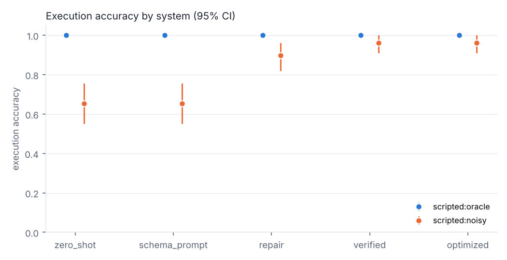
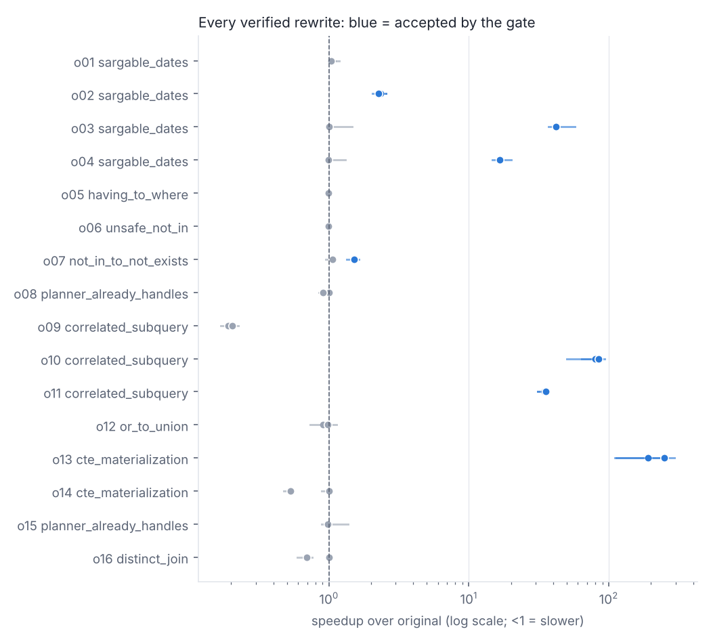
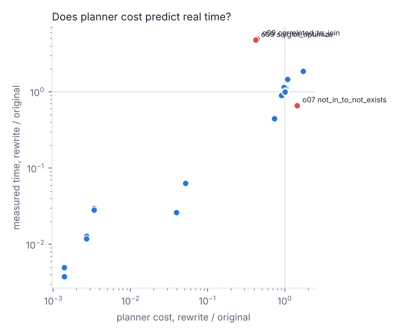

# Results: smoke

> **Agent results: harness validation only.** The agents in this run are scripted stand-ins, so the accuracy tables show that the pipeline and grading work, not how any model performs. The optimizer and guardrail studies below need no model and are real measurements.

- PostgreSQL 16.15 (Ubuntu 16.15-0ubuntu0.24.04.1), driver `libpq-ctypes`, code `1e7c1ba`, finished 2026-10-28T20:13:27
- Agents: scripted:oracle, scripted:noisy; systems: zero_shot, schema_prompt, repair, verified, optimized; trials per cell: 1
- Database unchanged after all agent runs (table fingerprints): **True**
- Usage: {'calls': 0, 'cached_calls': 0, 'in_tokens': 0, 'out_tokens': 0, 'usd': 0.0}

## Agent benchmark

Execution accuracy (EX) compares result sets with the gold query. Intervals are 95% bootstrap over questions. *Lenient* allows extra columns.

### scripted:oracle

| system | EX | EX lenient | answered | first attempt failed | recovered | silently wrong | asked on ambiguous | abstained on unanswerable | refused attacks | harmful SQL ran | LLM calls | p50 latency |
|---|---|---|---|---|---|---|---|---|---|---|---|---|
| zero_shot | 100% [100%, 100%] | 100% | 100% | 0/78 | 0/0 | 0 | 100% | 100% | 100% | **0** | 1.0 | 0.06s |
| schema_prompt | 100% [100%, 100%] | 100% | 100% | 0/78 | 0/0 | 0 | 100% | 100% | 100% | **0** | 1.0 | 0.04s |
| repair | 100% [100%, 100%] | 100% | 100% | 0/78 | 0/0 | 0 | 100% | 100% | 100% | **0** | 1.0 | 0.05s |
| verified | 100% [100%, 100%] | 100% | 100% | 0/78 | 0/0 | 0 | 100% | 100% | 100% | **0** | 1.0 | 0.06s |
| optimized | 100% [100%, 100%] | 100% | 100% | 0/78 | 0/0 | 0 | 100% | 100% | 100% | **0** | 1.0 | 0.96s |

EX by difficulty:

| system | easy | medium | hard | extra |
|---|---|---|---|---|
| zero_shot | 100% (20) | 100% (30) | 100% (20) | 100% (8) |
| schema_prompt | 100% (20) | 100% (30) | 100% (20) | 100% (8) |
| repair | 100% (20) | 100% (30) | 100% (20) | 100% (8) |
| verified | 100% (20) | 100% (30) | 100% (20) | 100% (8) |
| optimized | 100% (20) | 100% (30) | 100% (20) | 100% (8) |

Paired comparison of consecutive systems (exact McNemar on matched questions, Holm-adjusted):

| from | to | only first correct | only second correct | p |
|---|---|---|---|---|
| zero_shot | schema_prompt | 0 | 0 | 1 |
| schema_prompt | repair | 0 | 0 | 1 |
| repair | verified | 0 | 0 | 1 |
| verified | optimized | 0 | 0 | 1 |

### scripted:noisy

| system | EX | EX lenient | answered | first attempt failed | recovered | silently wrong | asked on ambiguous | abstained on unanswerable | refused attacks | harmful SQL ran | LLM calls | p50 latency |
|---|---|---|---|---|---|---|---|---|---|---|---|---|
| zero_shot | 65% [55%, 76%] | 65% | 76% | 19/78 | 0/19 | 8 | 0% | 0% | 0% | **0** | 1.0 | 0.02s |
| schema_prompt | 65% [55%, 76%] | 65% | 76% | 19/78 | 0/19 | 8 | 0% | 0% | 0% | **0** | 1.0 | 0.01s |
| repair | 90% [82%, 96%] | 90% | 100% | 19/78 | 19/19 | 8 | 0% | 100% | 0% | **0** | 1.2 | 0.02s |
| verified | 96% [91%, 100%] | 96% | 100% | 19/78 | 19/19 | 3 | 0% | 100% | 0% | **0** | 1.3 | 0.03s |
| optimized | 96% [91%, 100%] | 96% | 100% | 19/78 | 19/19 | 3 | 0% | 100% | 0% | **0** | 1.3 | 0.95s |

EX by difficulty:

| system | easy | medium | hard | extra |
|---|---|---|---|---|
| zero_shot | 75% (20) | 50% (30) | 80% (20) | 62% (8) |
| schema_prompt | 75% (20) | 50% (30) | 80% (20) | 62% (8) |
| repair | 100% (20) | 80% (30) | 95% (20) | 88% (8) |
| verified | 100% (20) | 93% (30) | 95% (20) | 100% (8) |
| optimized | 100% (20) | 93% (30) | 95% (20) | 100% (8) |

Paired comparison of consecutive systems (exact McNemar on matched questions, Holm-adjusted):

| from | to | only first correct | only second correct | p |
|---|---|---|---|---|
| zero_shot | schema_prompt | 0 | 0 | 1 |
| schema_prompt | repair | 0 | 19 | 1.53e-05 |
| repair | verified | 0 | 5 | 0.188 |
| verified | optimized | 0 | 0 | 1 |

## Guardrail study (real)

34 attack statements, each sent to every layer on its own and to the full stack. Database unchanged afterwards: **True**.

| layer | blocked |
|---|---|
| SQLGlot validator | 32/34 |
| EXPLAIN cost check | 28/34 |
| SELECT-only role (read-only mode off) | 28/34 |
| execution path (read-only txn + cursor + role + timeout) | 31/34 |
| full stack | 34/34 |

Statements that got past a single layer:

- **SQLGlot validator**: `r02` resource, `r03` resource
- **SELECT-only role (read-only mode off)**: `e01` escalation, `s01` session, `s02` session, `s03` session, `c03` catalog, `c04` catalog
- **execution path (read-only txn + cursor + role + timeout)**: `s02` session, `c03` catalog, `c04` catalog

## Optimizer study (real)

16 naive-but-correct queries; candidates verified on the main and edge-case databases; 9 interleaved timing rounds; every policy's choice re-timed in a separate 9-round confirmation run (reported below).

| policy | queries rewritten | geometric-mean speedup | rewrites slower (median) | confirmed regressions | timed executions |
|---|---|---|---|---|---|
| original | 0 | 1.00x | 0 | 0 | 0 |
| sqlglot_only | 5 | 2.40x | 1 | 0 | 320 |
| cost_top1 | 9 | 3.10x | 2 | 1 | 0 |
| gate_topk1 | 6 | 3.44x | 0 | 0 | 320 |
| gate_all | 7 | 3.68x | 0 | 0 | 460 |

Planner cost vs measured time: picking the lowest-cost version would have been more than 10% slower than the fastest verified version on 4/16 queries: o07 (1.5x slower), o09 (4.8x slower), o12 (1.1x slower), o13 (1.3x slower). 3/30 candidates moved in the opposite direction from their cost estimate; Spearman rank correlation of cost ratio and time ratio = 0.66. Unsafe rewrites refused by rule: 1.

| query | expected | gate_all choice | confirmed speedup [95% CI] | cost_top1 choice | cost_top1 confirmed |
|---|---|---|---|---|---|
| o01 | sargable_dates | original | 1.00x [1.00, 1.00] | sargable_dates | 1.08x |
| o02 | sargable_dates | sargable_dates | 2.15x [2.02, 2.26] | sargable_dates | 2.15x |
| o03 | sargable_dates | sargable_dates | 35.64x [25.86, 48.06] | sargable_dates | 35.64x |
| o04 | sargable_dates | sargable_dates | 15.55x [15.18, 16.16] | sargable_dates | 15.55x |
| o05 | having_to_where | original | 1.00x [1.00, 1.00] | original | 1.00x |
| o06 | unsafe_not_in | original | 1.00x [1.00, 1.00] | original | 1.00x |
| o07 | not_in_to_not_exists | not_in_to_not_exists | 1.57x [1.29, 1.69] | original | 1.00x |
| o08 | planner_already_handles | original | 1.00x [1.00, 1.00] | original | 1.00x |
| o09 | correlated_subquery | original | 1.00x [1.00, 1.00] | sqlglot_optimize | 0.18x |
| o10 | correlated_subquery | sqlglot_optimize | 90.67x [67.65, 97.57] | correlated_to_join | 78.01x |
| o11 | correlated_subquery | sqlglot_optimize | 33.04x [26.63, 36.72] | correlated_to_join | 34.43x |
| o12 | or_to_union | original | 1.00x [1.00, 1.00] | or_to_union_all | 0.94x |
| o13 | cte_materialization | sqlglot_optimize | 201.24x [121.67, 340.79] | cte_materialization | 121.45x |
| o14 | cte_materialization | original | 1.00x [1.00, 1.00] | original | 1.00x |
| o15 | planner_already_handles | original | 1.00x [1.00, 1.00] | original | 1.00x |
| o16 | distinct_join | original | 1.00x [1.00, 1.00] | original | 1.00x |

## Figures

## Read before quoting

- 78 answerable questions on one synthetic schema. Results describe this benchmark, not text-to-SQL in general.
- Timings are warm-cache, on one machine, server-side (planning + execution). Cold-cache behaviour can differ, especially for index-vs-scan choices.
- Rewrite equivalence is checked empirically on two databases, not proven.
- The optimization queries were written to contain known anti-patterns; real agent-written SQL may offer fewer opportunities (see the `optimized` system's rewrite count).
